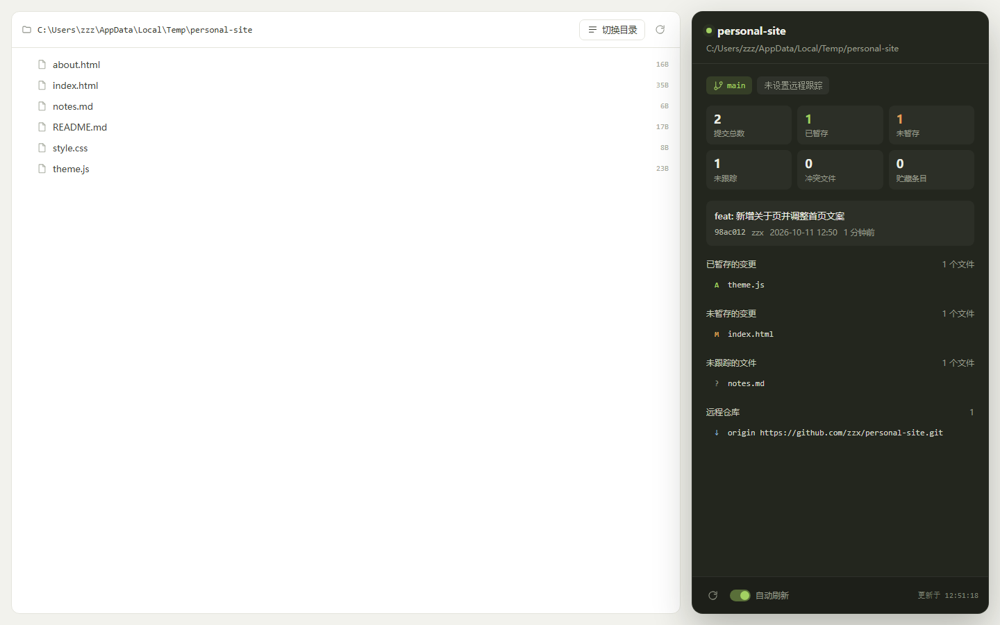

# Git 实时状态面板

一个本地运行的 Git 状态看板：左侧是工作区文件树，右侧是深色面板，
实时显示当前仓库的分支、提交、暂存区和工作区变更。



## 启动

```powershell
node server.js "D:\code\my-project"
```

把 `D:\code\my-project` 换成你自己的项目路径。不传目录时默认监控启动命令
所在的工作目录。

也可以用 `start.cmd "D:\code\my-project"` 双击启动，或直接把项目文件夹拖到
`start.cmd` 上。

启动后浏览器打开：http://127.0.0.1:63138

端口被占用时会自动往后找，终端里会打印实际地址。

## 让它在后台常驻

双击 `start.cmd` 会留一个黑色控制台窗口，关掉窗口服务就停了。
想要无窗口、且登录后自动运行，用隐藏启动器：

```powershell
wscript.exe "D:\111\git-live\serve.vbs" "D:\code\my-project"
```

`serve.vbs` 会以隐藏窗口拉起 `server.js`，不弹控制台。

取消开机自启：删掉启动文件夹里的 `GitLivePanel.vbs`，
路径是 `%APPDATA%\Microsoft\Windows\Start Menu\Programs\Startup`。

## 能看什么

- 当前分支、远程跟踪分支、领先/落后提交数、分离头指针提示
- 提交总数、已暂存、未暂存、未跟踪、冲突、贮藏条目
- 最近一次提交的哈希、作者、时间和说明
- 四组文件明细：冲突、已暂存、未暂存、未跟踪
- 已配置的远程仓库地址
- 没有仓库时显示「尚未初始化 Git」，并提供一键初始化按钮

面板每 3 秒自动刷新一次，可以在底部关掉自动刷新或手动点刷新。

## 切换项目

点左上角「切换目录」，可以逐级浏览磁盘，也可以直接把路径粘贴进输入框。

也可以直接用地址栏参数指定目录：

```
http://127.0.0.1:63138/?dir=D:\code\my-project
```

目录不存在时页面会给出提示并提供「选择目录」按钮。

## 说明

- 零依赖，只用 Node 内置模块 + 系统里已安装的 `git` 命令，不需要 `npm install`。
- 服务只监听 `127.0.0.1`，不会对外网开放，也不会修改仓库内容。
- 唯一会写入仓库的操作是你在界面上主动点击「初始化 Git」。
